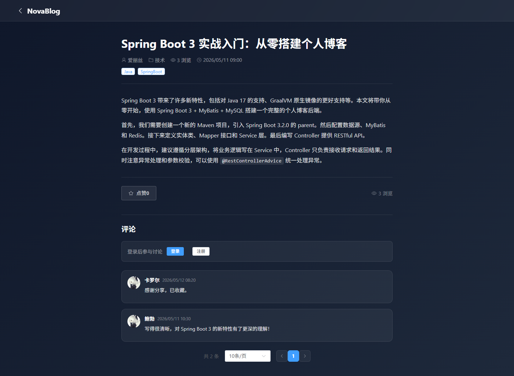
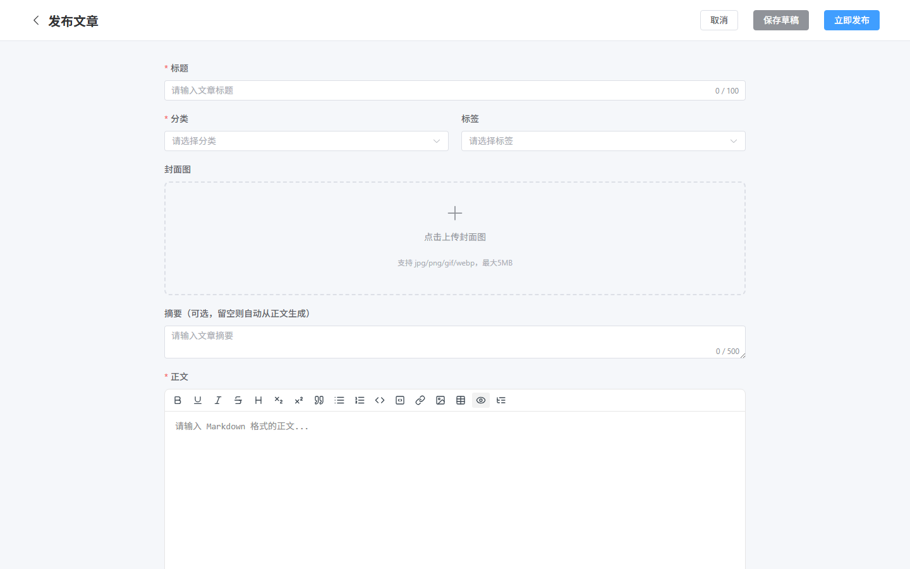
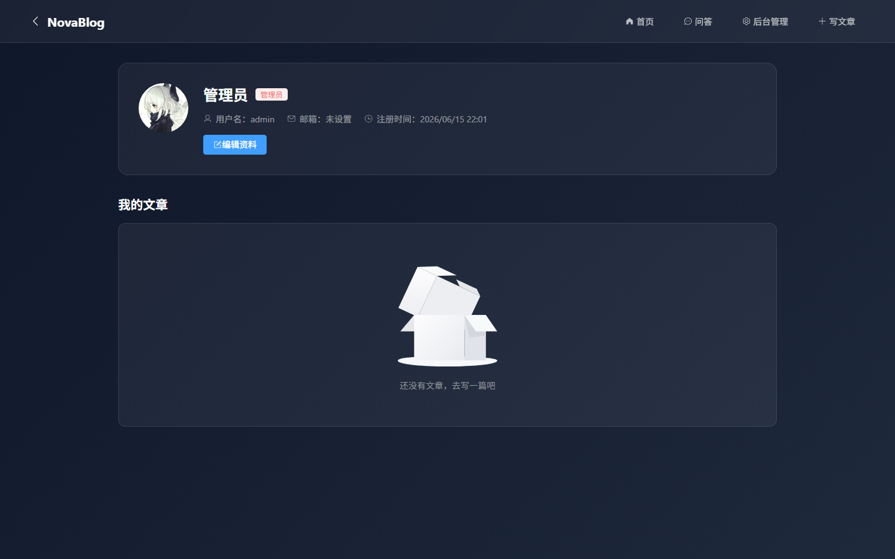
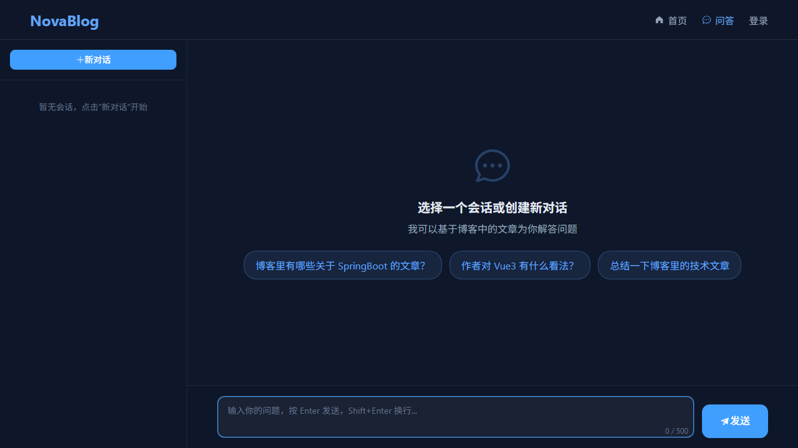
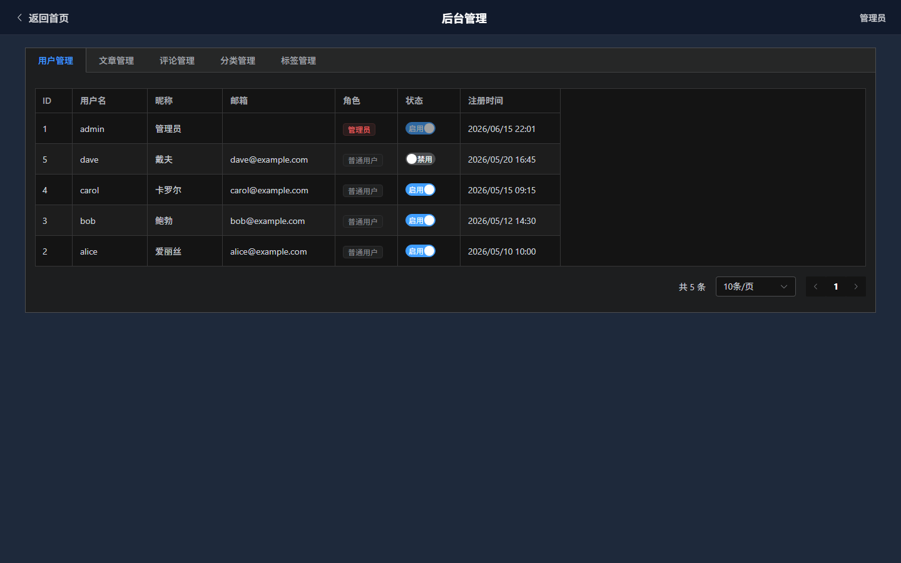

# NovaBlog

NovaBlog 是一个基于 SpringBoot + Vue3 的个人博客系统，具备完整的博客功能、JWT 认证与 RBAC 权限体系，并配套操作审计。此外还集成了 **AI 对话**与 **RAG 检索增强**能力，可以基于博客内容智能答疑。


## 技术栈

### 后端

| 技术 | 版本 | 用途 |
|------|------|------|
| Java | 17 | 编程语言 |
| SpringBoot | 3.2.0 | Web 框架 |
| Spring Security | — | 认证授权、BCrypt 密码编码 |
| MyBatis-Plus | 3.5.5 | ORM 框架（分页、条件构造） |
| MySQL | 8 | 关系型数据库 + JSON 向量存储 |
| Redis | — | 缓存、计数、排行榜、令牌状态 |
| JJWT | 0.12.3 | JWT 签发与校验 |
| Spring AI | 1.0.0 | AI 对话与 Embedding 抽象 |
| Spring AI Alibaba | 1.0.0.4 | 阿里云百炼/通义模型支持 |
| Knife4j | 4.5.0 | OpenAPI 3 接口文档 |
| 阿里云 OSS | 3.17.4 | 头像与文章封面对象存储 |
| Apache POI / PDFBox | 5.2.5 / 3.0.2 | 文章导入的 docx / pdf 解析 |
| Lombok | — | 简化样板代码 |
| Maven | — | 构建工具 |

### 前端

| 技术 | 版本 | 用途 |
|------|------|------|
| Vue | 3.5 | 前端框架 |
| Vite | 8 | 构建工具 |
| Vue Router | 5 | 前端路由与登录守卫 |
| Pinia | 3 | 状态管理 |
| Element Plus | 2.14 | UI 组件库 |
| Axios | 1.16 | HTTP 客户端 |
| md-editor-v3 | 5.4 | Markdown 编辑器 |
| marked | 18 | Markdown 渲染 |
| DOMPurify | 3.4 | XSS 防护 |

## 项目结构

```
NovaBlog/
├── docs/                   # 项目文档与截图
├── novablog-server/        # SpringBoot 后端
│   ├── pom.xml
│   ├── sql/                # 数据库初始化、RBAC 迁移与种子脚本
│   └── src/main/java/com/novablog/
│       ├── NovaBlogApplication.java
│       ├── aop/            # 权限校验、操作日志、时间自动填充切面
│       ├── chat/           # AI 对话模块（自带 controller/dto/entity/mapper/service/vo）
│       ├── common/         # Result, PageResult, UserContext, 异常, 注解, 常量, 枚举
│       ├── config/         # Security、AI 模型、MyBatis-Plus、OSS、Knife4j、Web 配置
│       ├── controller/     # REST 控制器
│       ├── convert/        # VO 装配
│       ├── dto/            # 请求/响应 DTO
│       ├── entity/         # 数据库实体
│       ├── mapper/         # MyBatis-Plus Mapper
│       ├── query/          # 查询条件对象
│       ├── rag/            # RAG 检索增强模块（自带 controller/interceptor/service/store）
│       ├── security/       # JWT 过滤器、令牌签发、UserDetails、认证失败处理
│       ├── service/        # 业务逻辑 + impl/
│       ├── task/           # 定时任务（浏览量同步、索引同步、Redis 预热）
│       ├── util/           # RedisUtil
│       └── vo/             # 视图对象
│   ├── src/main/resources/
│   │   ├── application.yml         # 公共配置
│   │   ├── application-dev.yml     # 本地开发配置（gitignore）
│   │   └── mapper/*.xml            # MyBatis XML 映射
│   └── src/test/java/      # 接口冒烟测试与 RefreshToken 流程验证
├── novablog-web/           # Vue3 前端
│   ├── src/
│   │   ├── api/            # Axios API 模块
│   │   ├── assets/         # 静态资源
│   │   ├── components/     # 公共组件（侧边栏、布局、后台管理页签）
│   │   ├── composables/    # 组合式函数
│   │   ├── router/         # 路由与登录/管理员守卫
│   │   ├── stores/         # Pinia 状态管理
│   │   ├── styles/         # 全局样式
│   │   ├── utils/          # 请求拦截器、Token 刷新
│   │   └── views/          # 页面组件
│   └── dist/               # 构建输出
└── README.md
```

## 快速开始

### 环境要求

- JDK 17+
- Node.js 18+
- MySQL 8
- Redis
- （可选）DeepSeek / OpenAI / 阿里云百炼 API Key

### 1. 克隆项目

```bash
git clone <repository-url>
cd NovaBlog
```

### 2. 初始化数据库

```bash
cd novablog-server
# 建库建表，并写入一个管理员账号 admin / Admin@123
mysql -u root -p < sql/init.sql
# 建 RBAC 权限表与登录、操作日志表，并把已有的 user.role 迁移到 user_role
mysql -u root -p novablog < sql/v2-rbac-migration.sql
```

如果需要体验带有模拟数据的完整效果，可继续导入种子数据：

```bash
mysql -u root -p novablog < sql/seed_data.sql
```

> `seed_data.sql` 内置了「面经」「项目笔记」「面试复盘」三个分类、20 个后端方向标签和 17 篇面试文章，附带评论与点赞数据，脚本会先清空既有测试数据再重新插入（保留 id=1 的管理员账号）。

### 3. 配置后端

```bash
cd novablog-server
# 复制开发配置模板
cp src/main/resources/application-dev.yml.example src/main/resources/application-dev.yml
# 修改 application-dev.yml 中的数据库、Redis、JWT 和 OSS 配置
```

配置项都写成 `${环境变量:默认值}` 形式，直接改配置文件或用环境变量注入均可。其中 JWT 密钥必须自行生成，且为 Base64 编码的随机字节（解码后至少 256 位）：

```bash
openssl rand -base64 64
```

其余需要关注的配置：MySQL 连接与 Redis 连接（本地默认值可直接用）、阿里云 OSS 的 endpoint / bucket / AccessKey（头像与文章封面上传依赖它）、`knife4j.enable`（接口文档默认关闭，置 true 后访问 `/doc.html`）。

AI 配置示例：

```yaml
ai:
  enabled: true
  chat:
    provider: deepseek
    deepseek:
      api-key: sk-xxx
      model: deepseek-chat
  embedding:
    provider: openai
    openai:
      api-key: sk-xxx
      model: text-embedding-3-small
  rag:
    top-k: 5
    rate-limit-per-minute: 10
```

### 4. 启动后端

```bash
mvn spring-boot:run
```

后端服务默认运行在 `http://localhost:8080`。

### 5. 启动前端

```bash
cd novablog-web
npm install
npm run dev
```

前端开发服务器默认运行在 `http://localhost:3000`。

## 核心功能

### 博客基础功能

- **用户模块**：注册、登录、JWT 认证
- **权限体系（RBAC）**：角色-权限-用户角色三层模型，内置 ADMIN / MODERATOR / USER 三种角色。登录时按 `user_role` 查出角色并以 `ROLE_` 前缀下发给 Spring Security，`@RequireAdmin` 据此拦截管理员接口；权限标识（如 `article:create`、`article:delete:own`）与角色权限映射已在库中维护，配套的校验切面也已就位，业务接口当前仍按「作者本人或管理员」的规则鉴权
- **文章模块**：发布、列表、详情、编辑、删除、Markdown 渲染
- **文章导入**：上传 md / txt / docx / pdf 文档，自动解析出标题、正文与摘要填入草稿
- **评论模块**：发表评论、嵌套评论、回复
- **分类/标签**：支持筛选与检索，默认面经方向
- **Redis 功能**：浏览量统计、点赞、热门文章排行
- **个人中心**：信息修改、头像上传、我的文章、用户名/密码修改
- **用户主页**：公开的用户资料页与文章列表
- **后台管理**：用户/文章/评论/分类/标签管理，支持用户关键词查询与批量删除；角色、权限的配置与分配
- **操作审计**：登录日志（含失败原因、IP、UA）与操作日志，增删改接口通过 `@LogOperation` 注解自动记录
- **文件上传**：头像、文章封面，存储于阿里云 OSS

### AI 功能

- **AI 对话**：登录用户可创建多轮会话，基于博客知识库回答问题；会话支持列表、重命名、删除单条消息与编辑后重新生成
- **RAG 检索增强**：文章自动切分并向量化，问答时先检索相关片段再生成回答
- **文章摘要**：为文章一键生成摘要
- **流式输出**：SSE 流式打字效果，支持 Markdown 渲染
- **来源引用**：AI 回答会标注引用的博客文章
- **模型可切换**：支持 DeepSeek、OpenAI、阿里云百炼

## 项目展示

### 首页

暗色主题下的文章列表，支持分类筛选、关键词搜索和热门文章侧边栏。


### 文章详情

Markdown 渲染正文、点赞按钮与嵌套评论系统。



### 文章编辑器

基于 md-editor-v3 的 Markdown 编辑器，支持封面上传、分类与标签选择。



### 个人中心

展示与编辑用户资料、头像上传以及"我的文章"管理列表。



### AI 对话

基于博客知识库的多轮对话，支持流式输出与来源文章展示。



### 后台管理

管理员可对用户、文章、评论、分类和标签进行统一管理。



## API 概览

后端采用 RESTful 风格，**不使用 `/api` 前缀**。前端通过 Vite 代理在请求时添加 `/api` 前缀，代理转发到后端时自动去除。

### 认证接口

| 功能 | 接口 | 说明 |
|------|------|------|
| 登录 | `POST /auth/login` | 返回 AccessToken、RefreshToken 与用户信息 |
| 注册 | `POST /auth/register` | 注册成功后直接返回登录令牌 |
| 刷新令牌 | `POST /auth/refresh` | 用 RefreshToken 换发新的一对令牌，RefreshToken 同步轮换 |
| 登出 | `POST /auth/logout` | 撤销当前会话，该会话的 AT 与 RT 一并失效 |
| 当前用户 | `GET /auth/profile` | 需携带有效 AccessToken |

> `POST /user/login` 与 `POST /user/register` 是等价的兼容入口，内部委托同一套 `AuthService` 实现。

### 基础资源

| 资源 | 创建 | 查询 | 更新 | 删除 |
|------|------|------|------|------|
| 用户 | `POST /auth/register` | `GET /user/profile` | `PUT /user/profile` | — |
| 用户主页 | — | `GET /user/{id}`, `GET /user/{id}/articles` | — | — |
| 用户（管理）| — | `GET /user/admin/list?keyword=...` | `PUT /user/admin/status` | `DELETE /user/admin/batch` |
| 文章 | `POST /article` | `GET /article/list`, `GET /article/{id}`, `GET /article/hot` | `PUT /article` | `DELETE /article/{id}` |
| 文章（管理）| — | `GET /article/admin/list` | — | — |
| 文章导入 / 摘要 | `POST /article/import`（上传 md/txt/docx/pdf 解析出草稿）, `POST /article/summary`（生成摘要） | — | — | — |
| 文章互动 | `POST /article/like/{id}` | `GET /article/like/status` | — | `DELETE /article/like/{id}` |
| 评论 | `POST /comment` | `GET /comment/list` | — | `DELETE /comment/{id}` |
| 评论（管理）| — | `GET /comment/admin/list` | — | — |
| 分类 | `POST /category` | `GET /category/list` | `PUT /category` | `DELETE /category/{id}` |
| 标签 | `POST /tag` | `GET /tag/list` | `PUT /tag` | `DELETE /tag/{id}` |
| 文件 | `POST /upload` | — | — | — |

### 后台管理接口

`/admin` 下的接口要求 ADMIN 角色（`@RequireAdmin`），用于维护 RBAC 权限体系与查阅审计日志。这套接口后端已实现，前端后台页面目前只接了用户、文章、评论、分类、标签五个模块，角色与权限管理尚未接入界面。

| 功能 | 接口 |
|------|------|
| 角色列表 | `GET /admin/role/list` |
| 角色的增删改 | `POST /admin/role`, `PUT /admin/role/{id}`, `DELETE /admin/role/{id}` |
| 配置角色权限 | `PUT /admin/role/{roleId}/permissions` |
| 权限列表 | `GET /admin/permission/list` |
| 查询 / 分配用户角色 | `GET /admin/user/{id}/roles`, `PUT /admin/user/{id}/roles` |
| 登录日志 | `GET /admin/login-log` |
| 操作日志 | `GET /admin/operation-log` |

### AI 接口

| 功能 | 接口 |
|------|------|
| 创建会话 | `POST /chat/session` |
| 会话列表 | `GET /chat/session/list` |
| 会话详情 | `GET /chat/session/{sessionId}` |
| 重命名 / 删除会话 | `PUT /chat/session/{sessionId}/title`, `DELETE /chat/session/{sessionId}` |
| 删除单条消息 | `DELETE /chat/session/{sessionId}/message/{messageId}` |
| 同步问答 | `POST /chat/ask` |
| 流式问答 | `GET /chat/ask/stream` |
| 编辑并重生成 | `PUT /chat/session/{sessionId}/message/{messageId}` |
| RAG 问答 | `POST /rag/ask` / `GET /rag/ask/stream` |
| 重建索引 | `POST /rag/reindex` |
| 索引状态 | `GET /rag/status` |

## 数据库设计

### 表结构

业务表：

| 表名 | 说明 |
|------|------|
| `user` | 用户，含 `bio` 个人简介字段 |
| `article` | 文章，含 `indexed` 索引状态字段 |
| `category` | 分类 |
| `tag` | 标签 |
| `article_tag` | 文章-标签关联 |
| `comment` | 评论，`parent_id` 支持嵌套、`reply_to_id` 记录被回复人 |
| `article_chunk` | 文章向量片段，用于 RAG 检索 |
| `chat_session` | AI 对话会话 |
| `chat_message` | AI 对话消息 |

权限与日志表（由 `v2-rbac-migration.sql` 建立）：

| 表名 | 说明 |
|------|------|
| `role` | 角色，内置 ADMIN / MODERATOR / USER |
| `permission` | 权限标识，如 `article:create`、`article:delete:own` |
| `user_role` | 用户-角色关联，一个用户可拥有多个角色 |
| `role_permission` | 角色-权限关联，决定角色拥有的权限集合 |
| `login_log` | 登录日志，记录成功/失败、IP、UA 与失败原因 |
| `operation_log` | 操作日志，记录操作人、操作类型、对象与详情 |

### Redis + MySQL 双写策略

- 用户操作时先写 Redis（保证响应速度）
- 优先从 Redis 读取，Redis 异常时降级读 MySQL
- 浏览量、点赞定时任务每小时（整点）回写 MySQL，执行时用分布式锁保证多实例下只有一个节点在同步
- 应用启动时，若 Redis 为空，从 MySQL 加载初始值

### Redis 中的令牌状态

认证链路依赖 Redis 保存三类键，`blog:` 为统一前缀：

| Key | 内容 | 生命周期 |
|-----|------|----------|
| `blog:user:token:blacklist:{jti}` | 已失效的单张令牌 | 与该令牌剩余有效期一致 |
| `blog:user:token:session:{sid}` | 会话撤销标记 | 覆盖该会话令牌的最长剩余有效期 |
| `blog:user:token:rotation:{oldJti}` | 旧 RT 轮换后签发的新 RT | 仅宽限窗口内（默认 60 秒） |

### RAG 向量索引

- 文章发布/更新后自动异步切分并生成 Embedding
- 向量存储在 MySQL `article_chunk.embedding` JSON 字段中
- 检索时计算余弦相似度，返回最相关的 Top-K 片段
- 管理员可手动触发全量重建索引

## 安全规范

### 认证链路

Spring Security 以无状态（STATELESS）过滤链接管认证。`JwtAuthenticationFilter` 对每个请求校验 Bearer 令牌，通过后把认证信息写入 `SecurityContext`，并同步一份到 `UserContext` 供业务代码取当前用户；无论请求是否通过校验，过滤器都在 `finally` 中清理 `UserContext` 的 ThreadLocal——Tomcat 会复用线程，残留的上下文会被下一个请求读到，尤其是放行的公开接口会莫名拿到上一位访问者的 userId。

令牌校验遵循「先验签、再判断」的顺序，因为篡改过的令牌在解析 claim 时就会抛异常，不能先拿它去取 jti 查黑名单。依次检查：签名有效性 → 令牌类型是否为 ACCESS（RefreshToken 不能用来访问业务接口）→ 会话是否已撤销 → 单令牌是否在黑名单中。

用户状态与权限不从令牌里读，而是每请求按 userId 回查数据库（用户状态、角色、权限共 3 条 SQL）。这换来的是禁用用户、调整角色权限后立即生效，无需等待令牌过期；令牌中只保留 userId、sid 这类标识，不承载权限快照。

### 令牌轮换与失效

一次登录派生一个会话标识 sid，本次登录的 AccessToken 与 RefreshToken 共享它；后续每次刷新轮换出的新 RT 沿用同一 sid，把一次登录衍生出的历次令牌串成一个家族，以便整体撤销。

**每次刷新都轮换**。RT 用过一次即作废，把泄露窗口从「7 天」压缩到「一次刷新的间隔」，旧 RT 立即进入黑名单，即使此前已被截获也无法再用。

**宽限窗口收敛并发刷新**。多个标签页共享同一份 AT，会在同一时刻一起刷新。若不加处理，第一个请求轮换成功后，其余请求手里的旧 RT 立刻变成「重放」，真实用户会被自己踢下线。因此给旧 RT 保留 60 秒宽限窗口，用 `SETNX` 记录「旧 RT jti → 新 RT」的映射：并发请求读到映射后复用同一张新 RT，而非各自签发一张，保证一个旧 RT 只对应一张新 RT。

**超窗口重放判定为泄露**。宽限窗口外旧 RT 再次出现时，合法客户端手里早已是新令牌，只能判定令牌泄露。此时撤销整个会话家族，让攻击者与真实用户一起重新登录。

**登出撤销整个会话**。按 sid 写入撤销标记，该会话的 AT、RT 及历次轮换出的令牌一并立即失效；AT 恰好过期时凭请求体中的 RT 定位会话，所以登出接口本身对未认证请求放行，否则前端得先绕一圈刷新流程才能登出。

> 兼容说明：不含 sid 的存量令牌无法按会话撤销，登出时退化为单令牌拉黑，待其自然过期（AT 2 小时、RT 7 天）后该分支即失效。

### Redis 故障时的取舍

令牌状态存放在 Redis，而 Redis 抖动是常态，因此两类读取采取相反的降级策略：

- **查询「是否已失效」失败时放行**（fail-open）：黑名单、会话撤销状态的查询异常按未失效处理。放行只是让本应失效的令牌多活一会儿，不会造成破坏性动作；反过来若按失效处理，一次 Redis 抖动就会把全站用户踢下线。
- **查询「轮换映射」失败时上抛**（fail-dangerous）：轮换映射查不到意味着「确认不在宽限窗口内」，调用方会据此判定泄露并撤销整个会话。若把 Redis 异常也吞成「查不到」，一次正常刷新就会被误判为攻击，因此这里让异常向上抛出，按服务不可用处理。

### 其他

- **密码存储**：使用 BCrypt 哈希，强度因子 10
- **权限控制**：管理员专属接口以 `@RequireAdmin` + AOP 切面拦截，角色取自 RBAC 表实时查询的结果；文章、评论等资源的归属校验在业务层统一处理（作者本人或管理员），权限标识粒度的校验能力已实现但尚未在这些接口上启用
- **令牌参数**：AccessToken 2 小时，RefreshToken 7 天，密钥为 Base64 编码的随机字节（解码后至少 256 位）
- **文件上传**：限制图片格式（jpg/png/gif/webp），单文件不超过 5MB，使用随机文件名存储于 OSS
- **SQL 注入**：MyBatis-Plus 使用预编译参数
- **XSS 防护**：前端 DOMPurify 过滤用户内容
- **限流**：RAG 问答接口对 IP 进行分钟级限流
- **审计**：登录日志记录成功/失败、IP 与 UA；`@LogOperation` 注解自动记录管理类操作的增删改
